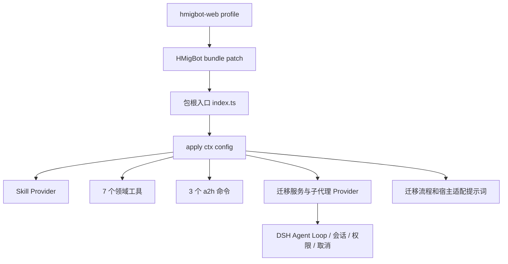
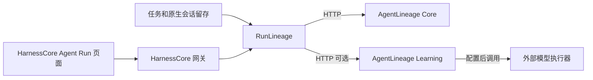

# DSH 101：插件机制、HMigBot 接入与 AgentLineage 组件化

> 本文用于 2026 年 10 月 13 日的技术分享，作为后续 PPT 的内容基础，供审核与修订。
>
> 实现说明与操作数据以 2026-10-10 的核对记录为依据，其中 AgentLineage 操作快照采集于北京时间 15:10。实验方案尚未执行，分组、样本量和评价目标仍待确认。

## 1. 文档范围与目标

本文首先介绍 DSH 的 profile、插件及注册机制，再以 hmigbot-dsh 为例，说明迁移相关的 Skill、Agent 和工具如何整体接入 DSH，并复用其运行流程。

组件化部分以 MigLoop 向 AgentLineage 的演进为例，说明项目内部能力如何形成可供其他项目使用的组件，包括交付内容、配置要求、依赖边界和公共 API。

量化评价是组件验证的重点。每个组件都需要在具体项目中形成可核对的操作数据，并通过对照实验评估定位效率、归因准确性、返修成功率及使用成本。“支持归因”和“积累经验”属于能力描述，实际效果仍需数据验证。

本文按照 **DSH 能力接入、可复用组件设计、项目量化验证** 的顺序展开，为其他组件的设计与评价提供讨论基础。

## 2. DSH 的插件机制与 profile

### 2.1 DSH 与 Cordis 的职责

DSH 负责组织 Agent 运行，通过插件组合模型、工具、会话、提示词、权限和 Agent Loop。

Cordis 提供底层插件机制。插件通过 `inject` 声明服务依赖；依赖可用后，Cordis 调用插件的 `apply(ctx, config)`，插件通过 `ctx` 注册相应能力。

插件可分别提供工具、Skill 或模型接入。业务能力通过相同的注册机制接入，并复用 DSH 的模型调用、会话管理与运行流程。

### 2.2 profile 的定义与配置

profile 是一组持久化的组合配置，用于确定某个 DSH 实例加载的能力包、依赖及运行配置。

例如，普通 Web profile 提供浏览器界面、模型、工具和会话；`hmigbot-web` 在此基础上增加 HMigBot 迁移能力。其他项目可按需求组合插件，并保存为独立 profile。

相关概念及其职责如下：

| 概念 | 职责 | 示例 |
|---|---|---|
| Plugin | 实现能力，注册工具、服务、Skill 或事件 | HMigBot 的 `dsh-plugin.ts` |
| Bundle | 封装待加载的插件配置，形成可分发的能力包 | 包内的 `cordis.patch.yml` |
| Profile | 选择 bundle，并保存对应依赖和配置 | `hmigbot-web` |
| Tool | 提供一次明确的调用，有输入、输出和执行逻辑 | `arkts_agent_run`、`lineage_query` |
| Skill | 定义能力的适用条件与执行方法，正文和资源按需读取 | `a2h-plan`、`migration-orchestrator` |

一个 npm 包可同时包含插件代码和 bundle 配置。profile 引用该包后，DSH 加载相应能力；同一能力包可被多个 profile 复用。

本文所依据的版本将 profile 保存在 `$DSH_HOME/profiles/<name>`：

```text
profiles/hmigbot-web/
  package.json          # 依赖和 dsh.profile.bundles
  cordis.patch.yml      # 这个 profile 自己的配置
  pnpm-lock.yaml        # 实际安装的依赖版本
  node_modules/         # 外部插件
```

`package.json` 中的 bundle 配置示例如下：

```json
{
  "dsh": {
    "profile": {
      "bundles": [
        "@deepseek-ai/dsh-base",
        "@deepseek-ai/dsh-web-app",
        "@fuxi-ailabs/hmigbot-dsh"
      ]
    }
  }
}
```

该示例仅展示组合字段，依赖由插件管理器维护。DSH 依次应用 bundle 配置，再应用用户配置与启动参数配置。

配置叠加顺序与插件启动依赖顺序分别管理。插件的服务依赖由 `inject` 声明。

`dsh --profile hmigbot-web --dump-config` 用于查看最终配置，`dsh --profile hmigbot-web` 用于启动该 profile。Web、headless 和 SDK 等运行形式也可通过 profile 配置选择。

### 2.3 插件注册与加载流程

插件从实现到使用包括以下五个步骤：

1. 实现插件入口，导出 `apply`，并声明服务依赖。
2. 在 `apply` 中注册工具、Skill、提示词或自定义服务。
3. 实现取消与卸载处理，清理工具注册、监听器及运行中的任务。
4. 在包清单中声明入口和 bundle patch，通过 patch 添加插件配置。
5. 安装至版本匹配的 profile，验证工具发现与调用。

AgentLineage 插件的注册骨架如下：

```ts
// 现有插件的注册骨架；工具定义在 createTools 中。
export const inject = ["tools"];

export function apply(ctx: Context, config: Config): void {
  const core = new LineageClient(config.coreUrl, credential(config.tokenEnv));
  const learning = config.learningUrl
    ? new LineageClient(config.learningUrl,
        credential(config.learningTokenEnv ?? "AGENTLINEAGE_LEARNING_TOKEN"))
    : undefined;

  for (const tool of createTools(core, learning, config.enableInvestigations))
    ctx.effect(() => ctx.tools.register(tool));
}
```

该插件依赖 DSH 的 `tools` 服务。依赖可用后，插件创建 HTTP 客户端并注册工具。`ctx.effect` 管理注册生命周期，在卸载时撤销注册。

示例省略了从环境变量读取令牌的 `credential` 实现，仅用于说明注册结构。插件卸载时移除工具注册，独立部署的 HTTP 服务生命周期由部署方管理。

## 3. hmigbot-dsh 的实现

### 3.1 迁移能力的整体封装

hmigbot-dsh 将迁移相关的 Skill、Agent persona、工具和命令封装为一个能力包，运行时复用 DSH 的 Agent Loop。

当前能力包包含 72 个来源 Skill、11 个来源 Agent、7 个领域工具和 3 个用户命令。运行时增加 `migration-orchestrator`，并提供 `general-purpose` 入口。

整体结构如下：



包根入口 `dist/index.js` 重新导出 `dsh-plugin.ts` 的 `apply`。包清单同时声明 bundle patch：

```json
{"dsh":{"bundle":{"patch":"./cordis.patch.yml"}}}
```

patch 通过以下配置加载能力包：

```yaml
- insert:
    - id: fuxi.arkts.migration
      name: '@fuxi-ailabs/hmigbot-dsh'
```

使用方在 profile 中安装 HMigBot 能力包后，由包内部统一完成 Skill、Agent、工具和命令注册。

### 3.2 能力注册与依赖

| 注册内容 | 接入位置 | 实际作用 |
|---|---|---|
| Skill Provider | `ctx.skills.registerProvider` | 提供名称与描述，并按需读取正文和资源 |
| 7 个领域工具 | `ctx.tools.register(defineTool(...))` | 资产查询、计划查询、Skill 读取、Agent 查询、派发预览与 Agent 执行 |
| 子代理 Provider | `ctx.subagents.registerProvider` | 以 `hmigbot-migration` 名称注册至原生子 Agent 目录 |
| 迁移服务 | `ArktsMigration extends Service` | 通过 `ctx.arktsMigration` 组织派发、权限和预算 |
| 提示词 | `ctx.systemPrompt.section` | 将旧资产中的 Skill/Agent 表达、路径和参数适配至当前宿主 |
| 用户命令 | `ctx.commands.register` | `/a2h-init`、`/a2h-run`、`/a2h-build` |

插件依赖 `skills`、`tools`、`agents` 和 `systemPrompt` 服务。`commands` 为可选依赖，通过 `ctx.inject(['commands'], ...)` 接入；最小 SDK 宿主未提供命令接口时，其余迁移能力仍可加载。

7 个工具分别为 `arkts_core_inventory`、`arkts_migration_plan`、`arkts_skill_catalog`、`arkts_skill_read`、`arkts_agent_catalog`、`arkts_agent_route`、`arkts_agent_run`。其中 route 提供派发预览，run 执行子 Agent 创建。

Skill 正文由宿主的 `skill` 工具按需读取，读取行为不扩大权限。子 Agent 的可用工具与父 Agent 可见工具取交集；任务父子关系、会话、取消和 UI 导航由 DSH 管理。

相关实现见[插件入口](D:/work/hmigbot-dsh/src/dsh-plugin.ts)、[工具注册](D:/work/hmigbot-dsh/src/tools-plugin.ts)、[运行器](D:/work/hmigbot-dsh/src/runner.ts)和[命令](D:/work/hmigbot-dsh/src/commands.ts)。

### 3.3 命令执行流程

`/a2h-init` 将初始化任务提交至主 Agent 的模型回合，解析 Android、HarmonyOS、DevEco、hvigorw、adb、hdc 路径。经确认后，写入并读回 `.migbot/config.json`；新目录可经确认生成脚手架。

`/a2h-run` 加载迁移编排指令，按 `spec → plan → execute → verify` 推进，使用各阶段 Skill，派发相应 Agent，收集项目产物。

`/a2h-build` 调用 `hmos-builder`，完成一次实际编译并检查结果。

三个命令均调用 `agent.steer()`，因此需要模型凭据，初始化过程也会产生模型调用。headless 的普通提示词不经过 Web 的 slash-command 分发，仅输入命令文本不足以证明命令处理器已执行。

当前四阶段主要由 Skill 与模型按照指令推进。`workflow.ts` 的阶段表提供流程描述，尚未实现持久化、强制执行的工作流状态机。验收需结合实际编译、测试和设备结果，不能仅依据 Agent 回合完成或报告文件存在。

### 3.4 安装和升级

安装器先检查工具链、构建、校验资产、生成 tarball，再从 DSH 模板建立 profile，执行 `dsh plugin --profile <name> add <tarball>`。最后检查组合配置和安装文件的 SHA-256。

同版本重新打包时，包管理器可能复用旧副本。安装器通过文件内容比较识别差异，并在不一致时执行 remove/add 重新安装。运行中的 DSH 需要重启以加载新模块。

### 3.5 项目操作数据与验证范围

当前项目证据来自 2026-09-23 的 DiceRoller 历史验证记录。该轮验证使用实际模型、编译器和模拟器，过程包含人工审批、执行恢复，以及代码和测试修正。

| 操作 | 历史记录 | 解释 |
|---|---|---|
| 打包资产 | 72 个 Skill、11 个 Agent | 交付规模 |
| 新工程初始化 | 3 分 35 秒 | 该轮初始化耗时 |
| 迁移产物正式增量编译 | 1 秒 758 毫秒，exit 0 | 指定产物的编译耗时，不代表全程迁移耗时 |
| 设备测试 | 单元 24；无障碍/应用主题 3；UI 验收 14 | 按套件分别统计，另有诊断探针 1 |
| 插件回归 | 25 passed，0 skipped，0 failed | 指定版本的自动回归记录 |
| 总体验收 | runnable, partial acceptance | 已具备运行能力，旋转、系统主题路径等仍未完整验收 |

上述数据说明插件在具体项目中的执行情况。完整迁移总工时、总 tokens、完整人工介入次数和对照组数据尚未采集，因此当前无法计算迁移效率提升比例。

HMigBot DSH 已关闭旧 HMigBot 账号和遥测集成，旧资产中的 `a2h metrics` 不适用于当前产品。后续数据需从 DSH 会话、编译和设备回执，以及人工操作计时中采集。

详细记录见[验收摘要](D:/work/hmigbot-dsh/docs/validation/DiceRoller-summary.json)和[验证说明](D:/work/hmigbot-dsh/docs/E2E-validation.zh-CN.md)。本文引用历史结果，未重新执行该轮迁移。

## 4. 可复用组件的适用条件

HMigBot 整体已可作为 DSH 插件使用。若进一步将其中部分能力提供给其他团队，需要明确该能力的输入输出、依赖边界和评价方法。

以下条件可作为组件设计的工程参考，属于本文提出的讨论框架，尚非 DSH 的统一认证标准。

| 评价维度 | 使用方要求 |
|---|---|
| 职责 | 职责明确，输入和输出可描述 |
| API | 通过公共接口调用，避免依赖内部目录、私有数据库或源码复制 |
| 交付 | 有版本、包、安装方法和兼容范围 |
| 依赖 | 明确模型、账号、设备和工程路径等要求 |
| 生命周期 | 支持升级、取消和卸载，明确数据保留规则 |
| 实际使用 | 至少在一个具体项目中通过公共入口执行，并保留操作记录 |
| 量化 | 指标分母、基线和成本明确，可解释实际改善效果 |

交付方式应根据功能特点选择：

| 功能特点 | 交付方式 |
|---|---|
| 主要提供规范和方法 | Skill，例如迁移计划审阅规范 |
| 输入输出明确、基本无状态 | 库或命令，按 Agent 调用需求封装为 Tool |
| 依赖 DSH 的权限、执行和子 Agent | DSH 插件或 Provider，例如 HMigBot 的迁移派发 |
| 需要独立证据库、跨项目查询和独立升级 | 独立服务与 SDK，并提供 DSH 插件适配，例如 AgentLineage |
| 将多个已有能力组合为产品 | profile 或 bundle |

组件应具有明确职责与使用边界，内部辅助函数可继续作为库实现。HMigBot 的迁移规则适合保留在迁移插件中；具有跨领域复用价值的证据查询、返修分析和经验管理适合独立封装。

## 5. MigLoop 向 AgentLineage 的演进

### 5.1 能力抽取与来源

AgentLineage 从固定版本来源抽取相关能力，并补充独立打包与公共接口。

| 抽取能力 | 来源 | AgentLineage 归属 |
|---|---|---|
| 原生材料索引、历史查询、证据引用、报告检查 | migbot-server 的 MigLoop inquiry runtime | Core 的 inquiry |
| 文件写入的行级重放和归属断链 | hmigbot-plus Insight | Core 的 lineage / observations |
| 问题分派、案例包装、经验版本、检索和指令 | migbot-server memorylib bundle | Learning |
| 独立包、HTTP、SDK、CLI、MCP、作业预算及宿主接入 | 新组件层 | 公共入口和 DSH 适配包 |

来源清单记录 63 个抽取文件，其中 62 个来自 migbot-server 固定 commit `207b9eb...`，1 个来自 hmigbot-plus `f867422...`。该数量用于来源核对，不用于评价业务效果。

MigLoop 上游、宿主 vendor 副本、运行代码及指令可能独立更新，单一 `0.x` 版本号不足以证明实现一致。来源核对以[逐文件来源](D:/work/AgentLineage/provenance.json)和[迁移说明](D:/work/AgentLineage/docs/migration.md)为依据。

### 5.2 Core、Learning 与接入层的职责

Core 负责原件与证据管理，包括会话保存、快照建立、索引与查询、工具和文件操作追踪，以及返修前后材料关联。

Learning 基于证据开展调查与经验管理，包括调查任务组织、模型草稿接收、引用和结构检查，以及经验保存、发布、撤回与检索。

DSH 插件将 HTTP 能力注册为 DSH 工具。调用方负责会话发现与保存、任务执行、审批和业务验收。

各部分的依赖分别管理。Core 主要依赖 Python 基础能力和 PyYAML；Learning 使用 Core 公共 SDK。迁移执行、ECAT、设备、云存储和监督功能保留在原项目中。

Learning 上传材料后，会在自己的数据目录里建立证据快照，不直接读取远程 Core 的私有数据库。因此两个服务的 source ID、snapshot ID 不能混用。

为兼容已有数据，组件保留 `migloop-case`、`migloop-memory` 等 schema 名称。鸿蒙环境规则作为扩展提供，通用能力不依赖鸿蒙工程。

### 5.3 原生会话接入的作用与边界

原生会话为返修归因提供证据基础，同时支持运行过程观察、工具操作定位、跨 Agent 文件修改追踪，以及调查结论与原始记录的关联。

组件保留 Claude、Codex 的 JSONL 和 DevEco 导出原件，并在查询索引中记录摘要。证据引用可包含来源 ID、SHA-256、原始行号或 JSON pointer，支持独立核对。

操作归属与缺陷因果需要分别评价。记录可支持“哪个 Agent 修改了哪些行”的判断；确认该修改是否导致缺陷，还需补充验证依据。材料缺失或写入无法重放时，应明确返回 partial、unknown 或断链状态。

## 6. AgentLineage API 与通用接入

### 6.1 服务形态与调用方式

HTTP API 是直接的跨项目接入方式。AgentLineage Core 可独立运行，其他项目通过 HTTP 上传材料、查询证据和建立返修关联。自动调查需要运行 Learning 并配置执行器。

其他入口包括 Python SDK、CLI、Viewer 和 Core MCP。SDK 用于 Python 项目嵌入，CLI 用于离线操作，Viewer 用于人工查看，MCP 用于 Agent 查询和报告提交。Core MCP 的 investigate 提供证据查询，与 Learning 的模型调查职责不同。

已实现接口见[implemented-v1](D:/work/AgentLineage/docs/interfaces/implemented-v1.md)、[observations-v1](D:/work/AgentLineage/docs/interfaces/observations-v1.md)和[live-streams-v1](D:/work/AgentLineage/docs/interfaces/live-streams-v1.md)。标记为 draft 的 OpenAPI 仍属于设计资料。

### 6.2 Core 的主要接口

| 操作 | API | 返回内容或作用 |
|---|---|---|
| 检查版本和支持能力 | `GET /v1/capabilities` | 组件版本、API 版本、格式和 feature |
| 关联项目任务 | `POST /v1/runs` | 用 external_key、project_id、objective 建立 Core run |
| 上传原件 | `POST /v1/sources?name=...&format=...` | source ID、摘要和大小；每来源上限 64 MiB |
| 建立快照 | `POST /v1/runs/{id}/snapshots` | 固定这一批材料，后续可以重读 |
| 查询会话和证据 | `POST /v1/snapshots/{id}/observations` | 分页、筛选、会话、文件、概览；正文支持分段读取 |
| 查询历史文件操作 | `POST /v1/query`、`POST /v1/lineage` | 文件、读写、差异、截止时刻、行级归属 |
| 同步和查询增量 | `GET .../live/state`；`POST .../live/append/upsert/query/freeze` | JSONL 字节追加、DevEco 消息更新、游标和快照 |
| 建立和读取返修关联 | `POST /v1/repairs`、`GET /v1/repairs/{id}`、`GET /v1/runs/{id}/repairs` | 前后快照、问题文件、问题描述和两侧证据 |
| 检查报告、读取原件 | `/v1/reports/check`、`/v1/reports`、`GET /v1/sources/{id}/content` | 检查或保存报告，核对原件 |

实时同步采用 HTTP 增量轮询。JSONL 按已确认的字节位置追加，DevEco 按原生消息变化更新。项目阶段、日志和资源信息可通过 `host-activity` 补充，并与原生会话分别标识。当前未提供 SSE。

### 6.3 LLM 依赖与执行边界

返修链建立、文件操作追踪、证据展示和查询均可由程序完成，不依赖 LLM。

自动解释问题原因、分析返修关系或生成经验草稿时，Learning 调用显式配置的 executor。执行器通常连接 LLM 或已有 Agent 运行器；AgentLineage 未预置默认模型供应商。

| Learning 的操作 | API 或 SDK | LLM 依赖 |
|---|---|---|
| 上传、准备调查材料 | `POST /v1/sources`；prepare / prepare_sources | 不需要 |
| 自动调查和生成案例草稿 | `POST /v1/investigations` | 调用显式配置的 executor |
| 读取、取消、恢复调查 | investigations query/get/cases/cancel/resume | 查询和取消不需要；恢复后可能继续执行模型工作 |
| 检查草稿 | SDK `pack_case` | 程序检查，也可以接收手工草稿 |
| 检索已有经验 | memory search/browse/read、cases read | 当前采用词法检索，不需要 LLM |
| 入库、撤回、归并经验 | cases ingest/withdraw、memory proposals | 接收明确提供的案例或 proposal，发布使用独立凭据 |

模型工作集中在 `case-draft` 阶段。执行器接收材料、任务、指令、校验反馈和剩余预算，返回草稿及实测 token 用量。校验失败时，程序将失败原因反馈至后续尝试。

HarnessCore 当前调查预算为最多 3 次调用、每问题最多 2 次尝试、120 秒和 8,000 tokens。缺少实测用量时判定执行失败，不按零用量统计。

调查结果以草稿保存，并标记 `semantic_verified=false`。引用与结构检查通过后，结论仍需复核。当前未提供自动模型 triage、自动经验 proposal 或自动批准发布流程。

### 6.4 通用项目接入流程

项目可从 Core 接入开始：

1. 安装并启动 Core，配置地址、令牌和数据目录。
2. 通过项目任务 ID 建立 Core run。
3. 上传原生会话，保存 source ID 和摘要。
4. 建立快照，保存任务与 run、snapshot 的映射关系。
5. 通过 API 或 Viewer 查询证据。
6. 按实时观测需求接入 append/upsert 和游标查询。
7. 根据前后运行与明确的问题建立返修关联；按自动调查需求接入 Learning 和 executor。

调用方负责会话发现与保存、认证、任务映射及材料缺口处理。新增日志格式需要相应 adapter，当前支持范围不涵盖任意自定义格式。

SDK 适用于 Python 嵌入或离线处理，HTTP 适用于跨语言调用与独立升级。当前服务按单 workspace 使用，完整多租户 ACL、分布式采集和高可用尚未验收。

### 6.5 HarnessCore 的 API 使用位置

HarnessCore 由后端调用 AgentLineage HTTP API，调用关系如下：



基础观测需要同时运行 HarnessCore 与 Core；自动调查还需运行 Learning。2026-10-10 15:10 的核对记录显示，三个服务均可访问，Learning 尚未配置模型执行器。

| 代码位置 | 使用的能力 |
|---|---|
| `control-plane-gateway.server.ts` | 建立客户端，提供 lineage 路由，并在接收运行观测后触发同步 |
| `run-lineage.server.ts` | 整理原件与项目活动；运行中约两秒采集；建立快照、查询、返修和调查 |
| `agentlineage-client.server.ts` | 调用 Core 的 capabilities、runs、sources、snapshots、live、observations、repairs |
| `agentlineage-learning.server.ts` | 上传 Learning 材料，启动、读取或取消调查，读取案例 |
| `agent-run-dashboard.tsx` / `run-lineage.tsx` | 展示会话、日志、调用图、时间线、资源用量和返修 |
| `repair-investigation.tsx` | 调查授权、草稿和依据链 |

浏览器通过 HarnessCore 的 `/api/control-plane/v1/.../lineage/...` 调用接口，组件令牌保留在后端。AgentLineage 查询故障不应影响任务控制状态。

观测与返修调查已完成接入。Learning 的 memory search/ingest/proposals 尚未进入 HarnessCore 自动资产优化流程，经验复用对后续任务的收益仍待接入与验证。

相关实现见[接入说明](D:/work/harnessCore/docs/agentlineage-integration.md)、[Core 客户端](D:/work/harnessCore/platform/apps/web/lib/agentlineage-client.server.ts)、[Learning 客户端](D:/work/harnessCore/platform/apps/web/lib/agentlineage-learning.server.ts)和[RunLineage](D:/work/harnessCore/platform/apps/web/lib/run-lineage.server.ts)。

## 7. AgentLineage 的 DSH 插件接入与分发

AgentLineage 的通用能力由 Core 和 Learning 提供，DSH 插件将 HTTP 操作封装为模型可调用的工具。

| 配置 | 提供的工具 | 对应操作 |
|---|---|---|
| Core | `lineage_query` | 调用 `/v1/query`，查询已有快照 |
| Core | `lineage_open` | 检查快照，返回 Viewer 链接 |
| Core | `lineage_check` | 调用 `/v1/reports/check` |
| 配置 Learning | `lineage_memory_search` | 调用 `/v1/memory/search` |
| 配置 Learning | `lineage_cases` | 读取已有调查和案例 |
| 显式启用 enableInvestigations | `lineage_investigate` | 提交已上传的 Learning source IDs、triage 和 budget |

插件仅依赖 `tools` 服务。配置包含服务地址和令牌环境变量名，实际令牌从环境变量读取。调查写入默认关闭，插件不读取经验发布凭据。

当前插件未提供 DSH 原生会话自动采集或本地文件自动上传。材料需通过 HTTP 或 CLI 上传；`lineage_investigate` 使用 Learning 返回的 source ID，不接受任意执行命令。

分发流程与 HMigBot 类似：包声明 `dsh.bundle.patch`，通过 patch 插入插件，构建与检查后生成 tarball，并安装至版本匹配的 profile。当前包标记为 `private:true`，按组织内 tarball 使用；Core/Learning 采用实际 wheel，尚无公开包发布证据。

当前存在 DSH SDK 版本差异：HMigBot/HarnessCore 使用 `0.1.6-alpha.2`，AgentLineage 插件测试锁定 `0.1.6-alpha.1`，两者的 Cordis 均为 `4.0.2`。组合至同一 profile 前，需要统一并验证 DSH SDK；Cordis 版本一致不足以证明插件兼容。

HarnessCore 当前直接通过 HTTP 接入 AgentLineage，未使用该 DSH 插件，因此这条接入路径不要求共享 DSH SDK 版本。

已有验证覆盖真实 SDK 工具定义和 Python HTTP 跨进程调用。完整 DSH 宿主中的真实任务、工具查询、认证及断线错误、取消、安装升级和卸载仍待验证。相关代码见[插件实现](D:/work/AgentLineage/integrations/dsh/src/plugin.ts)和[包依赖](D:/work/AgentLineage/integrations/dsh/package.json)。

## 8. AgentLineage 的量化评价

### 8.1 操作数据与效果数据

会话接入量与返修链数量反映组件的实际使用规模。效果评价还需检验定位效率、归因准确性、修复通过率，以及后续同类任务的缺陷发生情况。

数据采集可分为以下层次：

| 评价层次 | 指标 |
|---|---|
| 使用规模 | 运行数、会话数、原件大小、查询数、返修和调查数 |
| 工程质量 | 证据覆盖、引用可回读、同步延迟、查询耗时、存储和资源开销 |
| 当前问题处理效果 | 定位耗时、诊断正确率、返修通过率、修复时间和成本 |
| 后续任务效果 | 同类任务成功率、问题复发率、修复轮次、每个成功任务成本 |

### 8.2 已采集的项目操作数据

操作快照采集于 2026-10-10 15:10，数据来自本机接口。统计方法为：将该时点 HarnessCore 列表中的任务 ID 与 Core 的 external_key 匹配，再统计关联运行的最新冻结快照。

| 项目 | 记录值 |
|---|---|
| 当前 HarnessCore 列表 | 1 条运行，total=1 |
| Core 列表 | 2 条运行，其中与当前宿主列表关联 1 条 |
| 关联运行的最新快照 | 1 个 |
| 原生会话 | 13 个 DevEco 会话 |
| 来源 | 14 个：13 个 DevEco + 1 个 host-activity |
| 索引记录 | 2,904 条 |
| 原生工具调用 | 656 次 |
| 原件字节合计 | 8,734,252 bytes，含 host-activity，按 source ID 去重 |
| 快照完整性 | partial |
| 关联运行的返修记录 | 查询返回 0 条 |
| Learning 执行器 | 未配置 |

该快照反映具体项目接入后的操作规模，可能包含开发或测试用途，不能直接作为生产采用量。统计范围仅包含最新冻结快照，未计入实时未冻结材料及全部历史快照。

Core 列表最多返回 100 条，返修列表每运行最多返回 100 条。本次 Core 列表未达到上限。2,904 条为索引记录，不等同于用户消息数；同一运行中的 13 个会话不构成 13 个独立实验样本。

当前尚无返修效果提升、归因正确率或经验复用收益的实测结果。聚合数据保存在[操作快照 JSON](D:/work/AgentLineage/docs/talks/evidence/2026-10-10-local-inventory.json)，其中不包含令牌、会话正文和任务目标。

### 8.3 第一阶段主指标：限定时间内的诊断完成率

第一阶段建议采用“有依据的诊断完成率（限定时间）”作为主指标：在相同材料与规定时限下，统计给出有依据且经独立复核正确判断的问题比例。

```text
有依据的诊断完成率（限定时间）
= 时限内通过独立复核的问题数 / 全部分配的问题数
```

通过复核需满足：问题位置与类别正确，关键结论可追溯至原件，并明确说明证据不足。对于原因无法确认的问题，应预先定义正确报告不确定性的评价标准。

人工试验可将 30 分钟作为候选时限，并根据问题难度确认；模型试验固定调用、时间和 token 预算。超时、失败和未完成结果均计入分母。

结合定位时间、误判情况、返修结果和成本指标，可进一步评价组件的实际作用。

### 8.4 指标定义与数据来源

| 指标 | 计算口径 | 数据来源 |
|---|---|---|
| 关键证据定位时间 | 从开始调查，到找到符合标准的关键证据 | 操作计时和最终 evidence ref |
| 引用可回读率 | 来源、摘要、坐标能核对的引用 / 尝试核对的引用 | Core query/content 和独立检查 |
| 证据覆盖率 | 采集到的可用材料或事件 / 调用方清单中应有的材料或事件 | 项目清单与组件对账；分母未知时记为 N/A |
| 归因正确率 | 与独立参照一致的可判定结论 / 全部可判定结论 | 专家复核、已知缺陷和验证结果；另报问题级正确率 |
| 无依据的因果判断比例 | 缺少支持的因果断言 / 全部因果断言 | 独立复核 |
| 首次返修通过率 | 首次修复满足业务验收且无指定回归的问题 / 分配返修的问题 | 实际编译、测试和设备回执 |
| 修复时间 | 问题确认到修复验收的实际经过时间；另记人员操作工时 | 项目运行和人工时间，拆出审批及环境等待 |
| 修复轮次 | 每个问题实际验证过的修复尝试，包括失败尝试 | run 和 repair 关联 |
| 每个成功问题的成本 | 所有分配问题的模型及人员成本 / 成功问题数 | 实测 tokens、明确费率、人员工时，保留失败成本 |
| 增量展示延迟 | 事件可采集到组件可查询的时间差 | 新增采集计时；缺少原生时间时用采集时钟 |
| 系统开销 | 固定规模下的查询时间、CPU、内存、存储和上传量 | 单独做工程基准 |
| 同类问题复发率 | 固定观察期内发生同类缺陷的任务 / 有相应风险的任务 | 固定缺陷分类和项目验收 |

引用可回读证明材料可核对，程序的 valid 字段证明结构与引用检查通过。归因正确性需要通过独立参照评估。

耗时结果应同时报告完成率、超时和失败情况。样本较少时，宜提供问题级数据或中位数与范围，不据此推断稳定的 P95 和提升率。当前尚无正式性能基准报告。

## 9. 返修链与经验复用的对照实验

### 9.1 分阶段验证

| 阶段 | 验证目标 | 实施条件 |
|---|---|---|
| 第一阶段：证据查询 | Core 是否提高人工证据定位效率 | 可优先实施，不依赖 LLM |
| 第二阶段：自动调查 | 同等模型和预算下，归因质量或成本是否改善 | 配置真实 executor，准备独立参照 |
| 第三阶段：经验复用 | 复核后的经验是否减少后续任务失败 | 完成发布、检索和后续任务消费接入 |

实验应从已有能力开始，逐阶段验证。返修链效果需通过处理结果比较；经验复用收益需在后续任务实际消费经验后评价。

### 9.2 第一阶段：证据查询方式比较

首个实验项目可选择已完成接入的 HarnessCore，候选案例可包括 HMigBot DiceRoller 历史问题，并补充其他独立任务。历史人工修改与介入情况应保留记录。

| 分组 | 使用方式 |
|---|---|
| A：现有方式 | 原始会话、文件、普通搜索和项目现有工具 |
| B：使用 Core | 使用相同材料，通过 Core 查询会话、文件操作和关联证据 |

两组应保持材料、访问权限和时限一致，按参与者经验分层随机分配，并控制问题难度。应避免同一参与者先后处理同一问题的两个版本，以减少答案记忆的影响。

实验任务可包括定位首次错误修改、识别缺失验收的阶段、区分环境失败与代码失败，以及追踪多 Agent 的文件操作衔接。评价范围首先限定为记录能够支持的事实。

独立评审者按预定标准评价匿名结果，比较限定时间内的诊断完成率、定位时间、引用正确性、误判和人员工时。效率提高但误判增加的情况应一并报告。

### 9.3 第二阶段：自动归因与案例生成比较

在隔离实验环境中配置模型执行器，并固定材料、问题、模型和预算。为区分证据查询与调查流程的作用，设置以下三组：

| 分组 | 实验方式 | 比较目标 |
|---|---|---|
| A：普通模型调查 | 同一模型读取原始材料，通过普通查询工具提交带依据的判断 | 现有基线 |
| B：Core + 普通模型调查 | 同一模型通过 Core 读取证据，保持普通调查要求 | B 与 A 的差异，评价证据查询组织的作用 |
| C：Core + Learning | 同一模型采用 case-draft、程序反馈和预算管理 | C 与 B 的差异，评价调查与案例生成流程的作用 |

三组统一实际模型标识、模型设置、可读材料、工具权限、全流程调用/token/时间上限及输出要求。A 组应具有相同完整材料的读取权限，避免将日志截断造成的差异归因于组件收益。

成本统计需包含执行器内部的所有模型子调用。组件外层预算不足以证明任意执行器均遵守上限，还需核对回执并验证供应商适配。无法核对的用量记为 unknown。

同一问题可重复执行以观察模型波动，但重复运行之间存在相关性。统计时应按问题汇总或进行问题级聚类重采样，避免将重复执行视为独立样本。

### 9.4 独立参照与评价方法

实验需预先准备独立参照答案。调查模型的自评和 Learning 的程序校验结果均不足以证明归因正确性。

案例集可包含以下三类问题：

1. 已确认、实际修复并验收的历史问题。根因未经验证时，保留不确定性。
2. 隔离工程副本中引入的已知缺陷。记录引入操作、时间、失败现象和恢复验证。
3. 原因无法确定，或属于环境、平台采集问题的案例，用于评价错误归责情况。

实验材料需固定时间截止点。评价修复前定位能力时，应排除正确修复 diff 和事后根因说明。评价返修前后解释时，两组应使用相同的前后材料，问题描述不能直接作为参照答案。

因果判断宜通过实际测试或受控回退与恢复验证。缺少此类条件时，应评价证据支持程度，并保留结论的不确定性。

### 9.5 试点规模与统计口径

第一轮可选择来自多个独立任务的 12–20 个问题，用于验证分组、计时和评分流程。该数量属于试点建议，不足以保证统计结论；单项目验证的结论也仅适用于相应项目范围。

执行前应固定问题、版本、分组、指标和失败规则，再根据试点中的效果差异与波动确定正式实验样本量。结果应包含问题级数据、差值和置信区间。

例如：

```text
耗时降低率 = (A 组耗时 − B 组耗时) / A 组耗时
完成率差值 = B 组完成率 − A 组完成率   # 用百分点报告
```

当前不填报提升比例。建议的待确认目标为：在判断正确性不下降、额外成本可接受的条件下减少定位工时。完成该阶段验证后，再评价实际返修通过率和修复时间。

### 9.6 第三阶段：经验复用效果评价

该阶段需先建立经验复核与发布流程，并完成 DSH 或其他项目的 memory search 接入。

实验固定 Harness、Skill 和模型版本，对比关闭经验检索与启用已发布经验检索的后续任务。后续测试任务应与案例生成问题分离，避免原答案泄漏至同一测试。

数据需包含检索命中、经验进入上下文、经验采用及任务业务验收情况，并据此比较成功率、同类问题复发率、修复轮次和每个成功任务的成本。

无收益、上下文开销增加或经验误导等情况应纳入结果报告。HarnessCore 当前尚未完成此类经验消费接入，实施实验前需补齐。

## 10. 分享结构与后续工作

### 10.1 PPT 内容结构

| 页 | 内容 |
|---|---|
| 1 | 组件接入与效果验证的目标 |
| 2 | DSH 101：plugin、bundle、profile |
| 3 | 插件入口、依赖、注册和卸载 |
| 4 | HMigBot 的整体接入 |
| 5 | Skill、Agent、工具与四阶段运行流程 |
| 6 | DiceRoller 已有操作数据和未完成验收 |
| 7 | 可复用组件的适用条件 |
| 8 | MigLoop 能力抽取与 AgentLineage 职责 |
| 9 | Core / Learning API 和通用接入 |
| 10 | AgentLineage DSH 插件及版本兼容 |
| 11 | 当前项目数据：1 条关联运行、13 个会话、656 次调用 |
| 12 | 定位、归因和经验复用的对照实验 |
| 13 | 待确认事项与后续工作 |

### 10.2 待确认事项与交付要求

| 工作项 | 交付要求 | 当前状态 |
|---|---|---|
| 第一个实验项目 | 项目、负责人、任务范围；建议先用 HarnessCore，HMigBot 提供业务案例候选 | 待确认 |
| DSH 版本统一 | AgentLineage 插件适配目标 SDK，验证真实调用、安装升级、取消和卸载 | alpha.1 / alpha.2 尚未统一 |
| 操作数据 | run、query、repair、investigation 的计数和耗时 | 目前仅有一次留存规模快照，完整查询统计和用户计时待补 |
| 问题和参照 | 固定材料、时间边界、根因或验收依据 | 当前关联运行没有返修记录，需要准备案例 |
| Core 实验 | 人员、分组、时限和评分标准 | 待确认 |
| Learning 实验 | 真实 executor、实测用量、A/B/C 比较 | 当前未配置模型执行器 |
| 经验复用 | 复核发布、检索接入、后续任务验收 | 当前未进入 HarnessCore 自动改进流程 |

### 10.3 效果报告模板

| 指标 | 基线组 | 组件组 | 差值和区间 | 样本说明 | 证据 |
|---|---|---|---|---|---|
| 限定时间内的诊断完成率 | 待采集 | 待采集 | 待计算 | 包含超时和失败 | 固定评分表、独立复核 |
| 定位时间和超时率 | 待采集 | 待采集 | 待计算 | 每个问题或中位数、范围 | 操作计时 |
| 归因正确率、无依据判断比例 | 待采集 | 待采集 | 待计算 | 可判定、不可判定分别记录 | 独立参照 |
| 首次返修通过率、修复时间 | 待采集 | 待采集 | 待计算 | 保留失败和人工介入 | 业务验收 |
| 每个成功问题的成本 | 待采集 | 待采集 | 待计算 | 包含失败成本和 unknown 用量 | 模型回执、人员工时 |

组件评价应基于具体项目的实际使用，记录操作数据，并通过一致的口径开展对照比较，形成可核对的效果结论。

## 附录 A：版本和实现范围

| 对象 | 核对版本或快照 | 说明 |
|---|---|---|
| hmigbot-dsh | 包 0.1.0；Git `b4af858` | 当时本机 main；DSH `0.1.6-alpha.2`、Cordis `4.0.2` |
| DSH 讲解依据 | 官方 tag `dsh-v0.1.6-alpha.2`；`ddefc45fbc7f8e46dd73185e68295696d1297887` | 与 HMigBot 的依赖对应 |
| 本机 DSH 源码主线 | `d743267388641bc76f17c45ce8b4c231aed1d32c`；app-boot `0.2.1-alpha.2` | 比产品依赖更新，不据此假定旧插件兼容 |
| AgentLineage Core / Learning | 源码、部署依赖和 HTTP 为 `0.1.0a7` | 2026-10-10 15:10 的核对记录 |
| AgentLineage DSH 插件 | `0.1.0-alpha.1` | 测试锁定 DSH SDK `0.1.6-alpha.1`、Cordis `4.0.2` |

AgentLineage 与 HarnessCore 接入包含未提交的工作区代码，尚不能据此确认远端发布状态。部分 README 和早期方案仍记录旧版本，实现行为以源码、包清单及注明时间的服务记录为依据。分享前需再次核对版本变化。

当前抽取源码按组织内私有包使用。NOTICE 未新增开源许可，公开分发前需确认来源许可与发布范围。

## 附录 B：代码和证据

| 内容 | 来源 |
|---|---|
| 固定版本 DSH 架构 | [官方 architecture.zh.md](https://raw.githubusercontent.com/deepseek-ai/deepseek-harness/dsh-v0.1.6-alpha.2/docs/architecture.zh.md) |
| 固定版本 profile 实现 | [官方 profile.ts](https://raw.githubusercontent.com/deepseek-ai/deepseek-harness/dsh-v0.1.6-alpha.2/packages/boot/app-boot/src/profile.ts) |
| 插件入口和生命周期 | [本机教程](D:/work/deepseek-harness/docs/cordis-tutorial/01-first-plugin.zh.md)；固定 tag 下的 cordis-primer |
| HMigBot 包与注册 | [package.json](D:/work/hmigbot-dsh/package.json)、[patch](D:/work/hmigbot-dsh/cordis.patch.yml)、[apply](D:/work/hmigbot-dsh/src/dsh-plugin.ts)、[runner](D:/work/hmigbot-dsh/src/runner.ts) |
| HMigBot 流程和政策 | [workflow](D:/work/hmigbot-dsh/src/workflow.ts)、[host-policy](D:/work/hmigbot-dsh/src/host-policy.ts)、[E2E](D:/work/hmigbot-dsh/docs/E2E-validation.zh-CN.md) |
| AgentLineage 来源 | [provenance](D:/work/AgentLineage/provenance.json)、[NOTICE](D:/work/AgentLineage/NOTICE.md)、[migration](D:/work/AgentLineage/docs/migration.md) |
| AgentLineage 包版本 | [Core](D:/work/AgentLineage/components/core/pyproject.toml)、[Learning](D:/work/AgentLineage/components/learning/pyproject.toml) |
| AgentLineage 接口 | [implemented-v1](D:/work/AgentLineage/docs/interfaces/implemented-v1.md)、[observations](D:/work/AgentLineage/docs/interfaces/observations-v1.md)、[live](D:/work/AgentLineage/docs/interfaces/live-streams-v1.md) |
| 返修证据 | [observations.py](D:/work/AgentLineage/components/core/src/agentlineage_core/observations.py) |
| 模型执行 | [executor 协议](D:/work/AgentLineage/docs/interfaces/executor.md)、[worker](D:/work/AgentLineage/components/learning/src/agentlineage_learning/worker.py)、[Learning SDK](D:/work/AgentLineage/components/learning/src/agentlineage_learning/api.py) |
| AgentLineage DSH 插件 | [plugin](D:/work/AgentLineage/integrations/dsh/src/plugin.ts)、[依赖](D:/work/AgentLineage/integrations/dsh/package.json) |
| HarnessCore 接入 | [依赖声明](D:/work/harnessCore/deploy/agentlineage-dependency.json)、[接入说明](D:/work/harnessCore/docs/agentlineage-integration.md) |
| 项目操作数据 | [2026-10-10 聚合快照](D:/work/AgentLineage/docs/talks/evidence/2026-10-10-local-inventory.json) |
