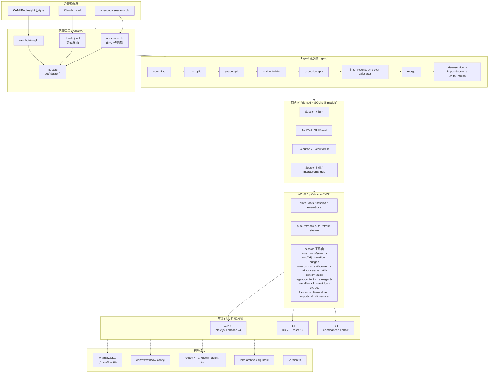
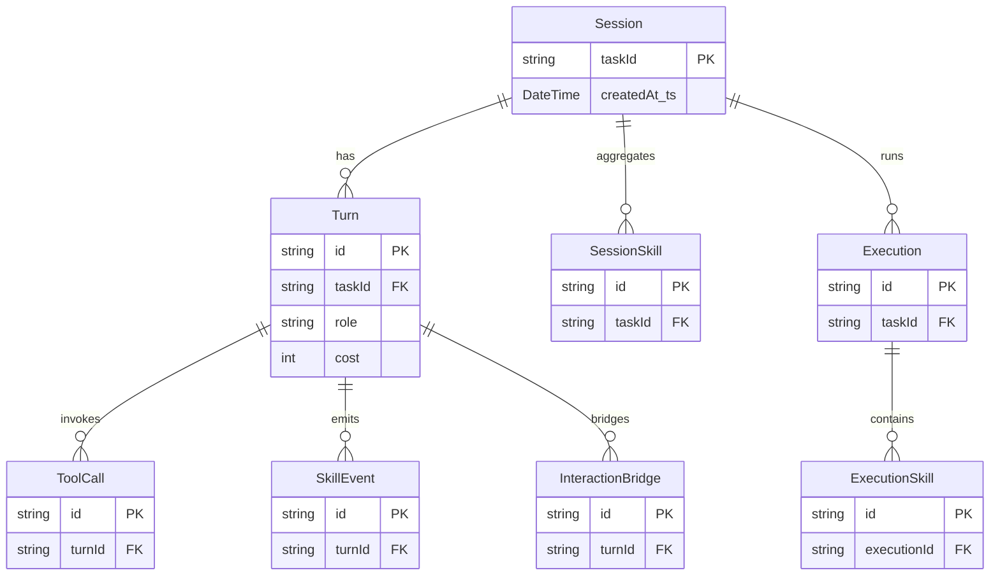

# CANNBot-Insight 架构图

> Session 级 LLM 编码 Agent(opencode)可观测性工具。Next.js 16 App Router + Prisma 6 + SQLite。

## 一、系统全景架构

```
┌─────────────────────────────────────────────────────────────────────────────┐
│                          外部数据源 (External Sources)                        │
│   opencode sessions.db   │   Claude .jsonl   │   CANNBot-Insight 自有库       │
└───────────┬──────────────────────┬──────────────────────┬──────────────────┘
            │ better-sqlite3 读      │ 文件读取             │
            ▼                       ▼                      ▼
┌─────────────────────────────────────────────────────────────────────────────┐
│                          适配器层 (Adapters)                                 │
│       src/lib/ingest/adapters/  —  适配器注册表 index.ts                      │
│   ┌─────────────────┐  ┌──────────────────┐  ┌────────────────────────┐     │
│   │  opencode-db    │  │   claude-jsonl   │  │   cannbot-insight      │     │
│   │ (N+1 子查询)    │  │  (流式解析)       │  │   (自有库读回)          │     │
│   └────────┬────────┘  └────────┬─────────┘  └───────────┬────────────┘     │
│            └──────────┬─────────┴────────────────────────┘                   │
│                       │ getAdapter(sourceType) → 统一 RawInteraction[]        │
└───────────────────────┼─────────────────────────────────────────────────────┘
                        ▼
┌─────────────────────────────────────────────────────────────────────────────┐
│                     数据处理流水线 (Ingest Pipeline)                          │
│                       src/lib/ingest/                                        │
│   RawInteraction                                                            │
│      │                                                                      │
│      ├─► normalize.ts        归一化(时间戳/角色/类型)                          │
│      ├─► turn-split.ts       按 Turn 切分                                     │
│      ├─► phase-split.ts      阶段切分                                         │
│      ├─► bridge-builder.ts   交互桥构建(InteractionBridge)                     │
│      ├─► execution-split.ts  执行单元切分                                     │
│      ├─► input-reconstruct.ts 输入重建                                        │
│      ├─► cost-calculator.ts  成本计算                                         │
│      └─► merge.ts           合并                                             │
│             │                                                                │
│             ▼  SkillEvent / 聚合                                            │
│      data-service.ts  (orchestrator)                                         │
│         ├─ importSession()        全量导入                                    │
│         ├─ deltaRefreshSession()  增量刷新                                    │
│         ├─ computeSessionAggregates()                                        │
│         └─ computeExecutionSkills()                                         │
└───────────────────────┬─────────────────────────────────────────────────────┘
                        ▼  createMany + $transaction
┌─────────────────────────────────────────────────────────────────────────────┐
│                     持久层 (Prisma 6 + SQLite)   8 models                   │
│  ┌──────────┐ ┌──────┐ ┌──────────┐ ┌───────────┐ ┌─────────────────────┐ │
│  │ Session  │ │ Turn │ │ ToolCall  │ │ SkillEvent│ │ Execution / ExecSkill│ │
│  └──────────┘ └──────┘ └──────────┘ └───────────┘ │ SessionSkill         │ │
│                                ┌──────────────────┐│ InteractionBridge    │ │
│                                │  src/lib/db.ts   │└──────────────────────┘ │
└───────────────────────────────┬┴──────────────────┘┴──────────────────────┘
                                ▼
┌─────────────────────────────────────────────────────────────────────────────┐
│                  API 层  22 个 /api/observe/* 端点                          │
│      stats │ data │ session │ executions │ auto-refresh(-stream)             │
│      session/{turns,turns/search,turns/[id],workflow,bridges,               │
│                wire-rounds,skill-content,skill-coverage,skill-content-audit,│
│                agent-content,main-agent-workflow,llm-workflow-extract,      │
│                file-reads,file-restore,export-md,dir-restore}                │
└──────┬───────────────────┬──────────────────────┬──────────────────────────┘
       ▼                     ▼                      ▼
┌─────────────────┐  ┌─────────────────┐  ┌──────────────────────────────────┐
│   Web UI        │  │      TUI        │  │            CLI                   │
│ Next.js server  │  │  Ink 7 + React19 │  │  Commander + chalk              │
│ + shadcn v4     │  │  src/cli/tui/    │  │  src/cli/index.ts               │
│ + Tailwind v4   │  │  App.tsx         │  │  client.ts (InsightClient)     │
│ + @base-ui      │  │                  │  │  → 17 方法封装                   │
│                 │  │                  │  │                                  │
│ page.tsx        │  │  (纯 API 客户端) │  │  types.ts (Api- 前缀)           │
│ session/[taskId]│  │                  │  │                                  │
│  settings       │  │                  │  │                                  │
│  workflow-flow  │  │                  │  │                                  │
│  compare        │  │                  │  │                                  │
│  monitor        │  │                  │  │                                  │
└─────────────────┘  └─────────────────┘  └──────────────────────────────────┘
       │                     │                      │
       └─────────────────────┴──────────────────────┘
                             │
                             ▼  前端共享类型 src/lib/shared/types.ts
┌─────────────────────────────────────────────────────────────────────────────┐
│                    辅助能力 (Cross-cutting Capabilities)                     │
│  AI 分析: analyzer.ts (OpenAI 兼容) │ trajectory-analyzer.ts                 │
│  上下文: context-window-config.ts   │ Web ContextTracker.tsx (需手动同步)    │
│  导出:   export-service.ts │ markdown-exporter.ts │ agent-io-export.ts       │
│  归档:   lake-archive.ts │ zip-store.ts │ file-restore / file-reads.ts    │
│  版本:   version.ts (展示版本，非 package.json)                              │
└─────────────────────────────────────────────────────────────────────────────┘
```

## 二、数据流（Ingest 主链路）

```
opencode sessions.db  ──better-sqlite3──►  opencode-db 适配器
    (N+1: per-session / per-message 子查询到 part 表)
                                                  │
                                                  ▼  RawInteraction[]
   normalize ─► turn-split ─► phase-split ─► bridge-builder ─► execution-split
                                                  │
                          ┌───────────────────────┤
                          ▼                       ▼
                   SkillEvent 聚合          cost / input 重建
                          │
                          ▼
              data-service.ts  importSession()
                          │  createMany + $transaction
                          ▼
              Prisma 8 models (SQLite)  ──►  /api/observe/*  ──►  Web/TUI/CLI
```

## 三、三种前端模式对比

| 模式 | 入口 | 渲染 | 共享 |
|------|------|------|------|
| **Web UI** | `src/app/page.tsx` (server, 直连 Prisma) | Next.js + shadcn v4 + Tailwind v4 + @base-ui/react | 同一 15+ 端点 API |
| **TUI** | `src/cli/tui/App.tsx` | Ink 7 + React 19 (ESM strict) | 纯 API 客户端 |
| **CLI** | `src/cli/index.ts` (Commander) | chalk + string-width + cli-truncate | `client.ts` 封装 17 方法（observe/ingest/ai） |

> Session 详情页 `session/[taskId]/` 为 `"use client"`，含 10 个 Tab（`wireRounds`/`replay` 默认隐藏，URL `?a` 或 `NEXT_PUBLIC_SHOW_ADVANCED_TABS` 展开），均从 `/api/observe/*` 拉取。

## 四、Mermaid 架构图



## 五、Prisma 8 模型关系



## 六、关键约束与注意事项

- **ESM strict**：`package.json` 含 `"type": "module"`，禁用 `require()`。
- **零 Prisma schema 变更**：特性开发不改 schema，计算数据在 API/渲染时构建。
- **Turn 无 cost 字段**：API 映射中设 `cost: 0`，写入前从 `TurnRow` 剥离。
- **`createdAt_ts` 可空**：fallback `createdAt` + `.toISOString()`。
- **ContextTracker 同步**：`context-window-config.ts` 与 Web `ContextTracker.tsx` 的模型映射需手动保持一致。
- **AI 分析**：仅 OpenAI 兼容 `/chat/completions`，必须 `response_format: json_object`；输入仅 root assistant/user/system turns，30K 字符预算。
- **Ink v7**：无 `lastFrame/frames/output`；禁用第三方组件(ink-table/ink-select/ink-spinner)，全部自实现。
- **CJK 宽度**：中文字符 = 2 列，CLI 一律用 `string-width`。
- **路径别名**：统一 `@/lib/...` / `@/components/...`，禁相对路径回溯。
- **GitCode 托管**：禁用 `gh` CLI。

<a id="agentlineage-integration"></a>

## 七、AgentLineage 功能与 API 合并

本次统一代码归属到 `guixu-labs/context-insight`。`agentlineage/` 从 AgentLineage `31c09b1` 迁入，保留 Python Core、可选 Learning、DSH 薄插件、测试和原始来源声明。`import-manifest.json` 记录迁入时各文件摘要；后续功能修改以本仓 Git diff 为准。迁入代码沿用 `agentlineage/NOTICE.md` 的来源与许可声明，不因同仓迁移自动改写原文件许可。

| 责任范围 | 业务能力与实现位置 | 本次边界 |
| --- | --- | --- |
| AgentLineage Core | `agentlineage/components/core`：原件保存、SHA-256、不可变快照、历史截止点查询、文件行归属、原文观测、返修链、机械校验、Viewer、SDK/CLI/MCP/HTTP | 行归属是记录中的写入事实；始终保留 `semantic_verified=false` |
| AgentLineage 对接 API | `src/lib/lineage`、`src/app/api/lineage`：Core 客户端、明确路由转发、Insight 会话绑定、快照关联 | 不复制证据算法，不读取 Core SQLite，不改 Insight Prisma schema |
| Lineage DSH 薄插件 | `agentlineage/integrations/dsh`：托管本地 Core、原生当前/历史/子会话导入、持久快照绑定和七个工具；消费同一 Core | 首次查询自动导入，继续工作后显式刷新；没有持续后台采集，模型分析效果需单独验收 |
| Learning（可选） | `agentlineage/components/learning`：调查、案例草稿、经验检索、独立发布权限 | 本次保留和回归原有能力；不新增模型执行器、不自动发布经验 |
| Insight 负责人 | 现有导入/刷新、指标、分析器、Web/TUI/CLI 展示、分析结果携带原生坐标 | 新会话绑定入口可直接调用；分析结果的具体 UI 跳转与分析器改造需由该侧接入 |
| 联合验收 | 相同材料版本、共享身份、引用映射、组合 Profile | 分别记录 Core、Insight API、DSH 运行时与 Profile 安装证据 |

### 启动和调用

Python 3.12+。在仓库根目录执行，Core 由部署方显式启动；Next 和插件均不持有 Core 子进程。

```powershell
python -m venv agentlineage/.venv
agentlineage/.venv/Scripts/python.exe -m pip install -e ./agentlineage/components/core
$env:AGENTLINEAGE_TOKEN = 'replace-with-a-local-service-token'
agentlineage/.venv/Scripts/agentlineage.exe --data-dir ./agentlineage/.work/state serve --port 8110
```

另一个终端设置同名 token 和 `$env:AGENTLINEAGE_CORE_URL='http://127.0.0.1:8110'` 后，按原方式启动 Insight。Linux/macOS 使用 `.venv/bin/python` 和环境变量的 shell 写法。关闭 Core 使用启动终端 Ctrl+C；关闭 Insight 不会关闭部署方的 Core。

`AGENTLINEAGE_CORE_URL` 未设置时新增入口返回 503，原有 Insight 功能可独立使用。远程 Core 要求 HTTPS 与 token；URL 不接受账号、路径或查询参数。超时通过 `AGENTLINEAGE_TIMEOUT_MS` 设置，默认 30000，范围 1..300000。`AGENTLINEAGE_PROJECT_ID` 默认 `context-insight`，共享 Core 的多个部署应设置不同值。凭据只保留在服务端，不进入浏览器 URL、快照或 API 返回。

| 方法 / Insight 入口 | 调用约定 |
| --- | --- |
| GET `/api/lineage/core/health`、`…/v1/capabilities` | Core 健康与实际能力；不是整个 Insight 的健康状态 |
| POST `/api/lineage/sessions/{sessionId}/snapshots` | `sessionId` 为 Insight 数据库行 ID；不接受客户端本地路径；读取该行已登记的原生 Claude/Codex 明文 JSONL，保存原件、run 与冻结快照，返回 `binding/source/snapshot` |
| `/api/lineage/core/v1/*` | 支持 Core 的 runs、sources、snapshots、imports/jobs、query、lineage、observations、repairs、reports 及 live/state/append/upsert/query/freeze；方法与正文沿用 [Core 接口](../agentlineage/docs/interfaces/implemented-v1.md) 和 [增量约定](../agentlineage/docs/interfaces/live-streams-v1.md) |
| POST `…/v1/snapshots/{snapshotId}/resolve` | `{source_id, sha256, pointer, record_id?}`；精确匹配快照内原文坐标，返回 `resolved/unresolved/ambiguous` 和候选公开记录 ID；不根据 quote、轮次或相似文本猜测 |
| POST `…/v1/snapshots/{snapshotId}/observations` | 首次查询列出 `record.id` 与 `record.evidence`；随后传 `{record_id}` 读取公开正文，按返回偏移续读 |

网关只转发上述 Core 数据接口；Viewer/login 保留在 Core 自身服务，Learning 保留原有独立服务。浏览器请求沿用 Insight 的来源校验。POST 保留 `Idempotency-Key` 和 Core 错误码；普通请求上限 1 MiB，原件及 live/upsert 上限 64 MiB。Core 的 409/422、查询批次内的逐项失败均保持原语义；HTTP 200 不代表批次每项成功。超时或断线不撤销已经提交的写入，应按稳定 ID 回读。

最小流程：先用现有 Insight 导入获得 `sessionId`，POST 创建绑定快照；再查询该快照 observations，取一条记录的 `source_id/sha256/pointer`，调用 resolve，最后用返回 `record_id` 回读。也可通过 Core 上传多份原件创建快照，保持原有多来源能力。

会话绑定按 `project_id + framework + taskId` 找到稳定 run，并在快照 context 中保留 Insight 行 ID、版本和更新时间。原生记录与同 taskId 的 proxy 记录不会混用。绑定入口当前只冻结登记的主文件，不自动发现子代理、不导入压缩件或目录、不刷新 Insight 投影；这些场景可由采集侧明确上传完整 source 列表。它返回 `primary-source-only` 缺口和 `projection_alignment=unverified`，因为既有 Insight 表未保存导入时原件摘要，不能证明当前文件恰好是分析器使用的版本。原文在读取中变化返回 409；严格解析不完整 JSONL 返回 422，持续输入应使用已有 live 接口。

Insight 分析器接入时，应保存生成结果时的 source 摘要和原生 pointer，再调用 resolve；没有坐标时保留“未定位”。同一原文行可能同时有文本和工具调用，此时返回 ambiguous，调用方选择具体 `record_id` 后再定位。旧材料摘要与新快照冲突返回 409，外来 source 返回 404。原件与快照不会被后续刷新覆盖。

### 验收与后续协作

按迁入的组件化 SOP 第 9 章及 L01-L05、实际触发的 E01/E02/E03/E04/E05 验收。可选 Learning 执行才触发 E06。实际命令、结果和未验证项见 `agentlineage/acceptance.context-insight.json`，它不替代通用验收模板。

Lineage DSH 包使用既有包名，运行时依赖已更新并固定到 DSH `0.2.1-rc.2` / Cordis `4.0.5`。实际 tgz 已在独立 Profile 安装，配置合成、启动、工具可见、成功调用与常见失败均已验证，未使用兼容性豁免。Insight DSH 插件尚未在本仓提供，联合 Bundle 需要该侧提供真实包名、版本和工具接口后组合。当前不注册占位 Insight 工具。该验证直接经过 DSH 工具运行时，不包含模型选工具或真实用户任务效果。

插件 0.1.0-alpha.3 配合 Core 0.1.0a10：默认使用 DSH subprocess 服务，在 Profile 启动时运行 loopback Core，系统分配端口，能力检查通过后注册工具。进程随 Profile/插件销毁，数据按 Profile 保留；同一数据目录的并发托管进程使用 OS 文件锁排他。external 模式继续由部署方管理 Core。DSH 的本地托管入口不改变上面的 Insight 外部服务部署方式。

会话导入读取 DSH sessionQuery 和官方 v4 codec，覆盖 live/cold、默认 zstd 历史文件、后代会话与分叉继承边界；Core 保存导出 JSONL 的原件和证据坐标。query/open/check 省略 snapshot_id 时使用当前 DSH 会话的持久绑定，首次自动导入。lineage_import 刷新或选择历史任务，lineage_sessions 分页列举，lineage_status 查看截止点，lineage_bind 切换显式快照。安装和手工验证见 [DSH 插件说明](../agentlineage/integrations/dsh/README.md)。

自动化集成测试从 JSONL 经 Insight 导入、Core HTTP、证据解析到原文回读；不调用付费模型。`AGENTLINEAGE_TEST_PYTHON` 可指定 Python 3.12 解释器，测试只使用独立 test.db 和临时 Core 状态。CI 增加独立 AgentLineage 工作流；远端是否执行通过须以该工作流结果为准。

独立检出测试不依赖相邻 `cpx` 源码；lake 脱敏使用 `tests/data/lake/redaction-contract.json` 的固定预期结果。安装 Core 依赖后，运行 `npm run test:all -- --maxWorkers=4` 检查 UT 与 E2E；`npm test` 仅运行 UT。CI 在 Ubuntu 上执行全套测试，Core/DSH 另在 Windows 与 Ubuntu 上检查。Insight 的 npm 包不携带 `agentlineage/`，Python wheel 与 DSH 插件按各自包目录构建和安装。
